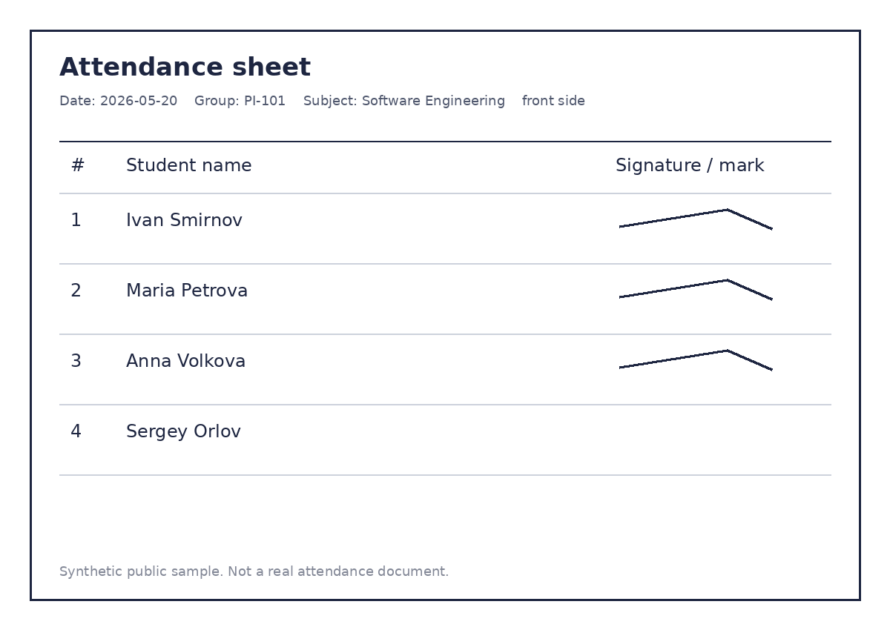

# Attendance OCR Service

Репозиторий содержит прототип сервиса автоматизированного учета посещаемости с применением OCR. Сервис принимает одно или несколько изображений листа посещаемости, сохраняет их по `image_id`, создает задачу обработки, запускает заменяемый OCR-адаптер, сопоставляет распознанные ФИО со списком студентов и предоставляет этап ручной проверки перед экспортом результата.

Проект сделан как сервисная оболочка вокруг OCR-компонентов: конкретная реализация OCR может быть заменена без изменения публичного API и пользовательского workflow проверки. Для локальной демонстрации в репозиторий включен синтетический пример в [app/static/demo/public-sample](app/static/demo/public-sample).

## Назначение системы

Бумажные листы самозаписи студентов удобны на лекциях, но ручной перенос отметок в электронный журнал занимает время и приводит к ошибкам. Данный сервис автоматизирует промежуточный этап: извлекает кандидатов на присутствующих студентов из изображения, сравнивает их с допустимым списком группы и позволяет преподавателю подтвердить или исправить результат перед экспортом.

## Примеры результата

В публичной демонстрации используются два синтетических изображения листа и небольшой синтетический список студентов:

<br>

Веб-интерфейс поддерживает:

* загрузку нескольких изображений для одного занятия;
* предпросмотр выбранных файлов перед обработкой;
* просмотр распознанных студентов в панели проверки;
* подтверждение результата перед экспортом;
* запуск встроенного demo-case без внешних данных.

## Проектное решение

### Pipeline обработки изображения

Основной workflow реализован вокруг [app/service.py](app/service.py), [app/job_processor.py](app/job_processor.py) и интерфейсов адаптеров из [app/ports.py](app/ports.py).

1. **Загрузка изображения**
   * Изображение валидируется и сохраняется через `ImageStorage`.
   * API возвращает `image_id`; байты изображения не передаются внутри payload задачи.

2. **Создание задачи**
   * Задача содержит контекст занятия, идентификаторы изображений, статус обработки, OCR-результат, состояние проверки и audit-события.

3. **OCR-распознавание**
   * `OcrAdapter` задает границу подключения OCR-реализаций.
   * В репозитории есть детерминированный stub-адаптер, demo-адаптер и адаптеры совместимости для legacy OCR pipeline.

4. **Сопоставление ФИО**
   * OCR-регионы типа `name` нормализуются и сопоставляются со списком студентов занятия.
   * Низкоуверенные и несопоставленные решения отправляются на ручную проверку.

5. **Проверка и экспорт**
   * Пользователь может подтвердить запись, отметить отсутствие, игнорировать запись или выбрать другого студента.
   * Экспорт заблокирован до подтверждения результата проверки.

### Backend-приложение

* **[FastAPI](https://fastapi.tiangolo.com/):** HTTP API и статический demo UI.
* **[Pydantic](https://docs.pydantic.dev/):** модели запросов, ответов и доменных сущностей.
* **SQLite:** локальное хранилище задач для разработки и демонстрации.
* **Pillow:** проверка изображений и извлечение метаданных.
* **pytest:** автоматизированные тесты сервисной логики и API.

## Структура проекта

Проект организован следующим образом:

- `app/`
  - `main.py`: создание FastAPI-приложения.
  - `routers/`: endpoint-ы для health-check, загрузки изображений, задач, review-flow и demo-вызовов.
  - `models.py`: доменные и API-модели.
  - `service.py`: создание задач, проверка, подтверждение, экспорт и audit-flow.
  - `job_processor.py`: запуск OCR и сопоставление результата.
  - `adapters.py`: реализации OCR- и LMS-адаптеров.
  - `storage.py`: файловое хранилище изображений.
  - `sqlite_repository.py`: SQLite-репозиторий задач.
  - `static/`: браузерный demo UI и публичный синтетический пример.

- `examples/`
  - `demo_attendance_sheet.png`: синтетическое изображение листа.
  - `create_job.json`: пример payload для создания задачи.
  - `demo_names.json`: пример списка студентов.
  - `smoke_dataset_manifest.json`: минимальный manifest для оценки OCR.
  - `smoke_ground_truth.json`: ground truth для smoke-набора.

- `scripts/`
  - `create_demo_sheet.py`: генерация синтетического изображения листа.
  - `evaluate_ocr_results.py`: расчет базовых OCR/matching-метрик.

- `tests/`
  - автоматизированные тесты API, matching, storage, review-flow, repository, audit trail и конвертации адаптеров.

## Установка из исходного кода

### Предварительные требования

Перед запуском необходимы:

* Python 3.10 или новее;
* установленный `pip`.

### Шаги

1. **Склонировать репозиторий:**

   ```bash
   git clone https://github.com/palmaus/attendance-ocr-service.git
   ```

   ...и перейти в каталог проекта:

   ```bash
   cd attendance-ocr-service
   ```

2. **Установить зависимости:**

   ```bash
   python -m pip install -r requirements.txt
   ```

3. **Запустить приложение:**

   ```bash
   uvicorn app.main:app --reload --port 8010
   ```

   По умолчанию API будет доступно по адресу:

   ```text
   http://127.0.0.1:8010
   ```

## Инструкция по использованию

1. **Открыть Swagger UI:**

   ```text
   http://127.0.0.1:8010/docs
   ```

2. **Открыть web-demo:**

   ```text
   http://127.0.0.1:8010/
   ```

3. **Загрузить изображение:**

   ```bash
   curl -X POST http://127.0.0.1:8010/attendance/ocr/images \
     -F "file=@examples/demo_attendance_sheet.png"
   ```

4. **Создать задачу:**

   ```bash
   curl -X POST http://127.0.0.1:8010/attendance/ocr/jobs \
     -H "Content-Type: application/json" \
     -d @examples/create_job.json
   ```

5. **Запустить demo-обработку задачи:**

   ```bash
   curl -X POST http://127.0.0.1:8010/attendance/ocr/jobs/{job_id}/process?mode=demo
   ```

6. **Проверить, подтвердить и экспортировать результат:**

   ```bash
   curl http://127.0.0.1:8010/attendance/ocr/jobs/{job_id}/review
   curl -X POST http://127.0.0.1:8010/attendance/ocr/jobs/{job_id}/review/confirm
   curl -X POST http://127.0.0.1:8010/attendance/ocr/jobs/{job_id}/export
   ```

## Формат результата

Ответ endpoint-ов задачи содержит OCR-регионы, сопоставленных студентов, решения проверки и текущий статус задачи.

```json
{
  "job_id": "job_...",
  "status": "completed",
  "image_ids": ["image_..."],
  "result": {
    "ocr": [
      {
        "image_id": "image_...",
        "regions": []
      }
    ],
    "students": []
  }
}
```

## Тесты

Для запуска автоматизированных тестов:

```bash
pytest -q
```

## Примечания

Репозиторий не содержит закрытых учебных документов, внутренних отчетов, локальных баз данных, реальных списков студентов или реальных фотографий листов посещаемости. Встроенные demo-данные синтетические и предназначены только для локального тестирования и демонстрации интерфейса.
